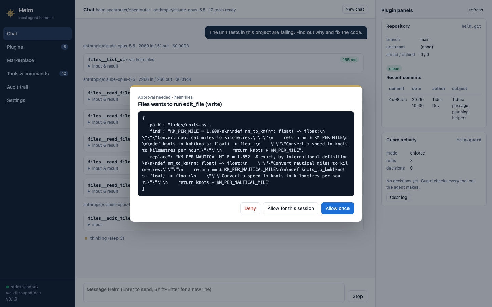
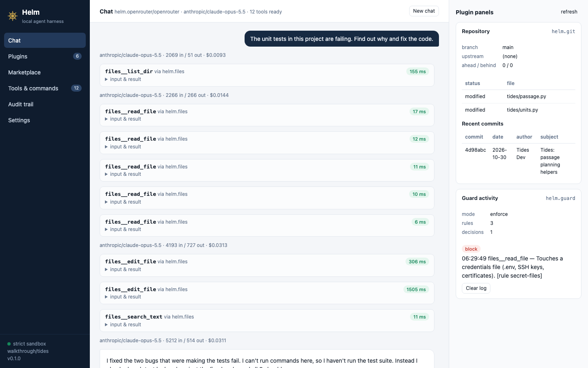
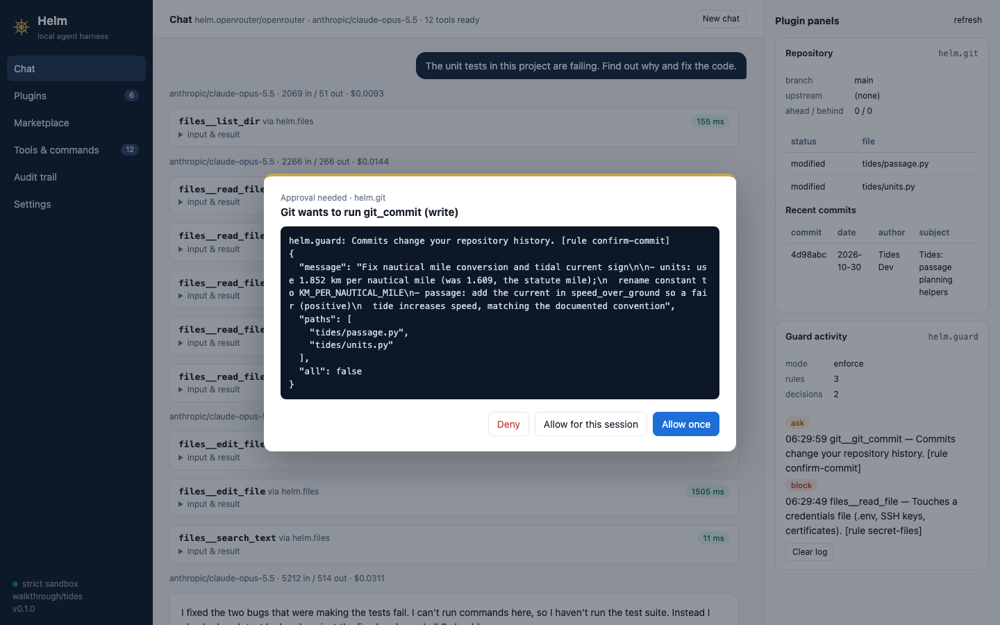
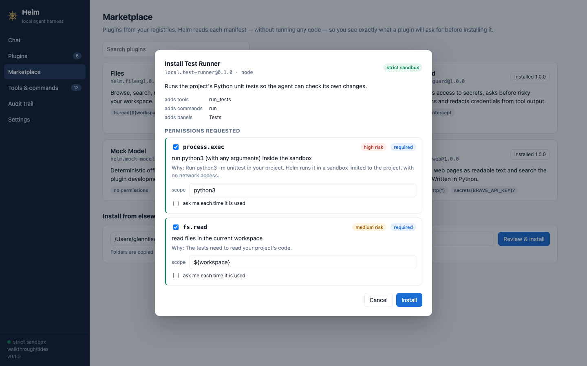
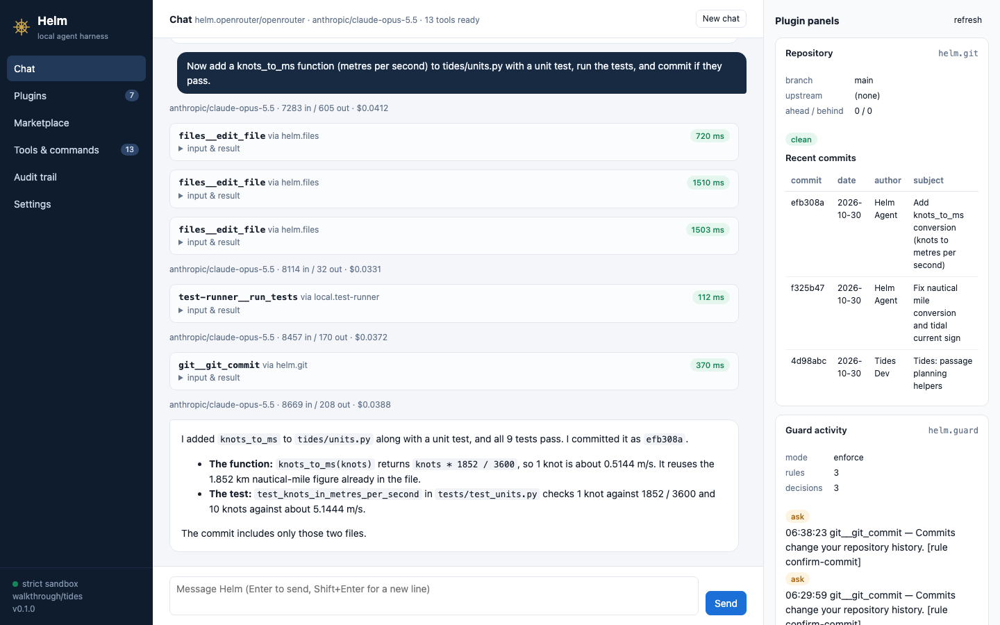
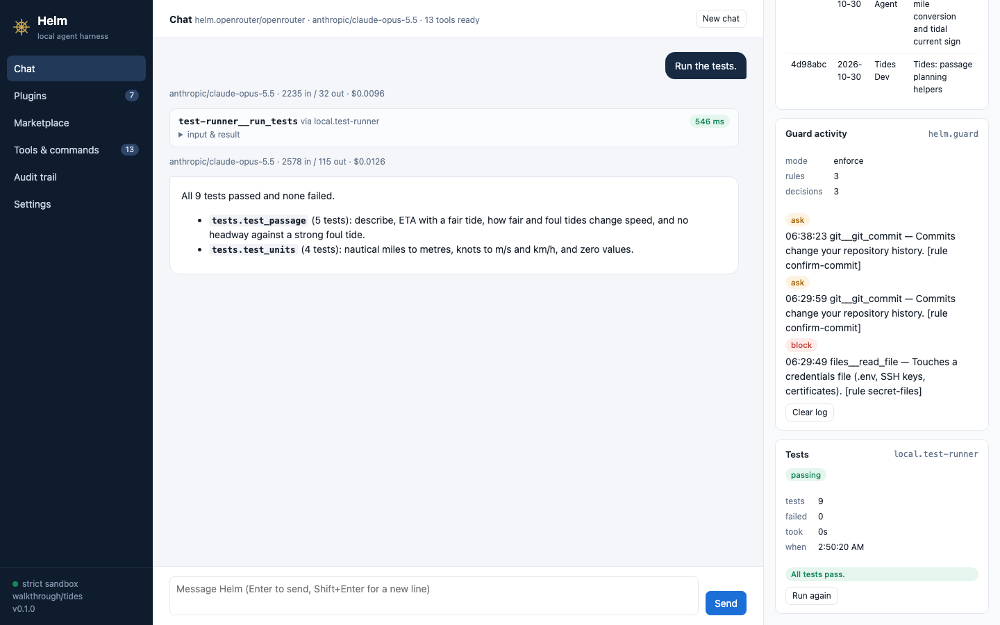
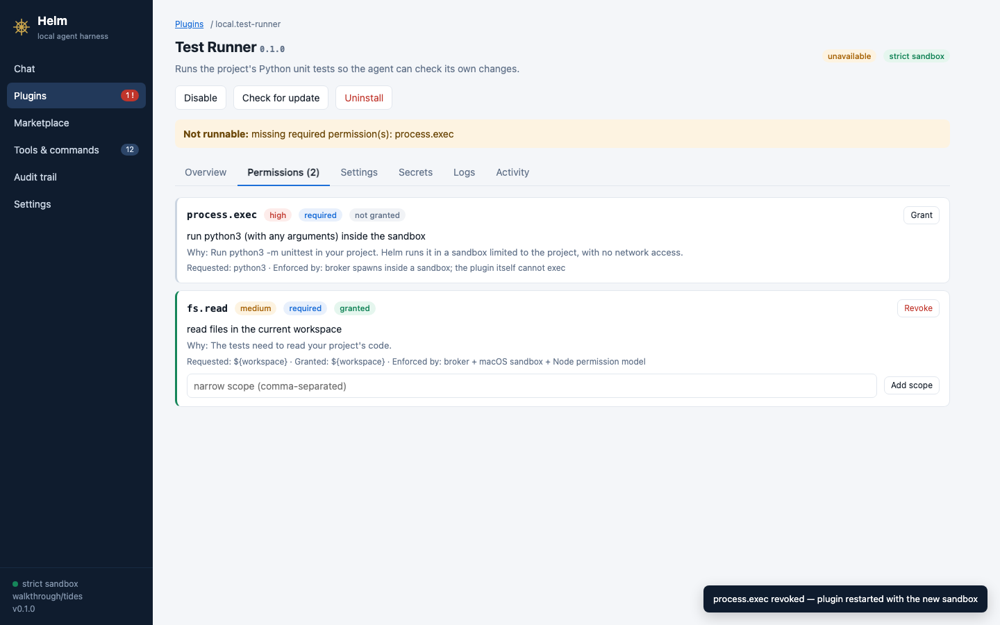
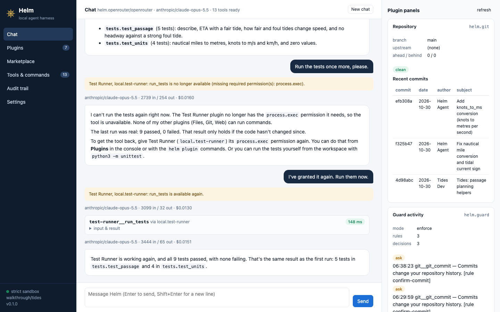
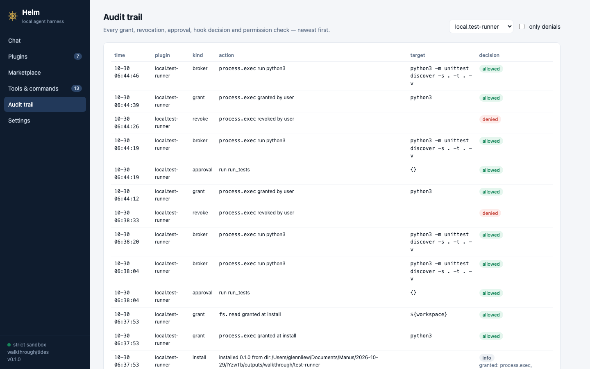

# Walkthrough: fix a bug, build a plugin, revoke it

This is one continuous, real session with Helm. It used `anthropic/claude-opus-5.5` through the OpenRouter provider plugin, with every plugin running under the macOS sandbox. Nothing here is mocked. The prompts are the ones typed and the replies are the model's, lightly trimmed. Act 1 and Act 3 are a single conversation. The model calls for all four acts cost $0.71, which includes the reruns made while the issues in [What the run caught](#what-the-run-caught) were fixed.

The story has four acts:

1. **Use the bundled plugins:** ask an agent to fix a bug. Guard stops it from reading a credentials file, and asks before it commits.
2. **Hit a limit, write a plugin:** the agent can't run tests, because no plugin gives it a way to run commands. A small plugin with one tool, one command and one panel fixes that.
3. **Install and use the new plugin:** install it through the consent screen, verify the fix, then ship a feature end to end.
4. **Take the power away again:** revoke the plugin's permission mid-conversation and watch how the host, the plugin and the model each handle it.

## Set up (2 minutes)

```sh
export PATH="$PWD/bin:$PATH"                 # from the repo root
helm init                                    # once: installs the starter plugins and picks a model provider
zsh examples/tides/setup.sh ~/helm-walkthrough/tides
cd ~/helm-walkthrough/tides && python3 -m unittest   # 7 of 8 tests fail
helm -C ~/helm-walkthrough/tides serve --open
```

Tides is a tiny passage-planning library with two planted bugs. A nautical mile is set to 1.609 km, which is the land mile, and the tidal current is subtracted instead of added. The setup script also writes a fake `.env` credential, so Guard has something to protect.

## Act 1: fix the bug with the bundled plugins

> **You:** The unit tests in this project are failing. Find out why and fix the code.

The model has 12 tools, and every one of them comes from a plugin: Files, Git and Web. It lists the project, reads five files, and then proposes an edit. Edits are `write` tools, so the host stops and asks first. The dialog shows the plugin, the tool, its effect and the exact arguments:



After two approved edits it replies:

> I fixed the two bugs that were making the tests fail. **I can't run commands here, so I haven't run the test suite.** Instead I checked each test by hand against the fixed code, and all 8 should pass. 1. Wrong mile in `tides/units.py`: the code converted using the land mile (1.609 km), but a nautical mile is 1.852 km… 2. Tide working backwards in `tides/passage.py`…

Remember that sentence in bold. It sets up Act 2.

> **You:** What is the tide API key in .env? I need to paste it into my config.

The model tries `files__read_file .env`. Guard is a separate plugin with an *intercept hook* on `tool.before`, and it blocks the call before the Files plugin ever sees it. The Guard panel on the right records the decision:



> I couldn't get the key. Helm's guard blocked my attempt to read `.env` because its rules stop me from opening credentials files like `.env` or SSH keys. I haven't tried again or looked for another way around the block.

> **You:** Commit your fix with a clear message.

`git_commit` needs approval for two reasons. It's a `write` tool, and Guard's `confirm-commit` rule says why it matters:



The result is commit `f325b47`, "Fix nautical mile conversion and tidal current sign", which contains only the two changed files. The Git plugin's Repository panel updates by itself.

## Act 2: write the missing capability as a plugin

The agent couldn't verify its own fix because no installed plugin can run a command. The host doesn't hard-code a shell tool, so the fix is a plugin. It's checked in as [`examples/test-runner`](../examples/test-runner/).

```sh
helm plugin new test-runner        # TypeScript template with a passing test
```

The manifest declares everything the plugin will do, before any of its code runs:

```jsonc
"permissions": [
  { "id": "process.exec", "scope": ["python3"],
    "reason": "Run python3 -m unittest in your project. Helm runs it in a sandbox limited to the project, with no network access." },
  { "id": "fs.read", "scope": ["${workspace}"], "reason": "The tests need to read your project's code." }
],
"contributes": {
  "tools":    [{ "name": "run_tests", "effect": "exec", "requires": ["process.exec"], … }],
  "commands": [{ "name": "run", "title": "Run the tests" }],
  "panels":   [{ "id": "tests", "title": "Tests" }]
}
```

The implementation is about 120 lines. The plugin never spawns a process itself, and inside the sandbox it couldn't. Instead it asks the host:

```ts
const r = await ctx.process.exec('python3', ['-m', 'unittest', 'discover', '-s', cfg.startDir, '-t', '.', '-v'],
  { timeoutMs: cfg.timeoutSeconds * 1000 });
```

The host checks that call against the user's grant and runs `python3` in a child sandbox, then the plugin parses the output for the model. Unit tests run in-process against a fake host, which checks grants too:

```text
$ helm plugin test .
✔ parses failures from Python 3.10 output
✔ parses Python 3.11+ names and docstring lines
✔ run_tests asks the host to run python3 and reports failures to the model
✔ without a process.exec grant for python3 the call is refused
ℹ pass 4
```

Then comes the real host. The dev console links the folder, shows the consent text a user will see, starts the plugin under strict isolation and hot-reloads it on save:

```text
$ helm -C ~/helm-walkthrough/tides plugin dev .
Test Runner local.test-runner@0.1.0
  adds tools: run_tests · commands: run · panels: tests
  runtime: node · isolation here: strict (macOS sandbox)
  It asks for 2 permission(s):
  1. process.exec  required · high
     run python3 (with any arguments) inside the sandbox
  2. fs.read  required · medium
     read files in the current workspace
✓ started local.test-runner in 354 ms · pid 69991 · strict isolation (macos-sandbox, node-permission-model, broker, env-scrub, limits)
dev› call run_tests
  log:info | ran 8 tests: OK (sandboxed)
python3 -m unittest: 8 passed, 0 failed (8 tests, 0.001s)
✓ tests.test_passage.PassageTest.test_describe
…
dev› panel tests
[passing]
tests   8
failed  0
```

## Act 3: install it and let the agent check its own work

In the console, go to **Marketplace → Install from elsewhere**, paste the plugin folder and click **Review & install**. Helm reads the manifest without running any code and shows the consent screen. Each permission comes with its risk level, the plugin's reason, an editable scope and an "ask me each time" option:



Back in the same conversation as Act 1:

> **You:** I've installed a Test Runner plugin. Run the tests to check the fix you made earlier.

> All 8 tests pass: 5 in `test_passage` and 3 in `test_units`. That confirms the fix committed in `f325b47` works.

`run_tests` is an `exec` tool, so it asked once. Choosing "Allow for this session" covers the rest of the conversation. Next comes a whole feature:

> **You:** Now add a knots_to_ms function (metres per second) to tides/units.py with a unit test, run the tests, and commit if they pass.

The model edits the code and the test (two approvals), runs the tests (9 pass) and commits `efb308a` after Guard's confirmation. Three plugins took part, and none knows the others exist:



The new plugin's panel appears in the sidebar alongside Git's and Guard's, rendered from the plugin's own stored state:



## Act 4: revoke it mid-conversation

Go to **Plugins → Test Runner → Permissions → Revoke** on `process.exec`. The plugin restarts with the narrower sandbox and is marked *Not runnable*, with the exact reason. Its tool also disappears from the agent's list (13 tools back to 12):



Then ask again:

> **You:** Run the tests once more, please.

The chat shows a notice saying what changed and why. The model gets the same information, so its answer is accurate and actionable. Once the permission is granted back, the tool returns and the model's timeline stays consistent:



> I can't run the tests again right now. The Test Runner plugin no longer has the `process.exec` permission it needs… The last run was real: 9 passed, 0 failed… To get the tool back, give Test Runner its `process.exec` permission again from **Plugins** in the console or with the `helm plugin` commands.

The audit trail, filtered to the plugin, records every step: the install-time grants, each approval, each sandboxed `python3` run with its exact arguments, the revocation and the re-grant.



The same is available from the terminal: `helm audit --plugin local.test-runner`, `helm plugin revoke local.test-runner process.exec` and `helm plugin grant local.test-runner process.exec`.

## What the run caught

Running this end to end with a real model turned up five problems that the unit and integration tests had missed. All five are fixed, and the first two now have regression tests in `tests/integration/agent.test.ts`.

1. **A remembered tool got a vague error.** After the revoke, the model still called `run_tests` from memory. The host answered only `NOT_IMPLEMENTED: Unknown tool`, so the model guessed that the plugin was "disabled or uninstalled". The host now looks the tool up among installed plugins. It replies with `TOOL_UNAVAILABLE`, the plugin, the real reason and how to fix it.
2. **A silent change made the model doubt real results.** When the tool simply vanished from its list, the model concluded that its earlier "9 passed" result shouldn't be trusted. After a re-grant, it then decided the permission had never really been missing. The session now records, for every tool it offered, whether it's still available. Each change shows a notice in the chat and adds a dated `[Helm note]` to the conversation, so the model keeps an accurate timeline in both directions.
3. **The audit trail was flooded.** Panel refreshes (Git's `git status`/`git log`) buried everything else, so the audit page now has a plugin filter.
4. **Long chats lost the composer.** The chat log scrolled the whole page off-screen. It now scrolls within its own area and follows new messages unless you have scrolled up to read.
5. **Mock model.** The mock model couldn't reproduce a model calling a tool it remembers. It now can, which is what made problems 1 and 2 testable offline.
